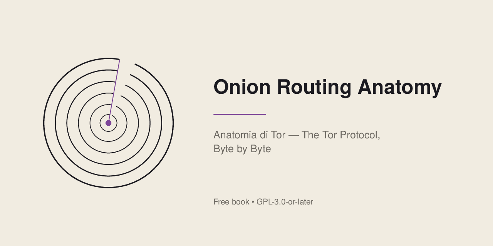
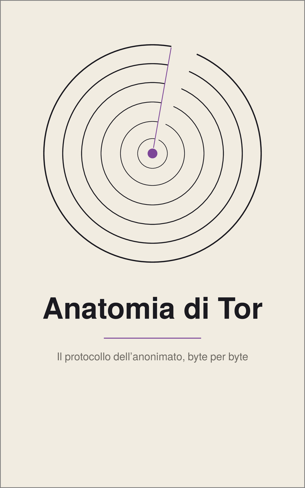
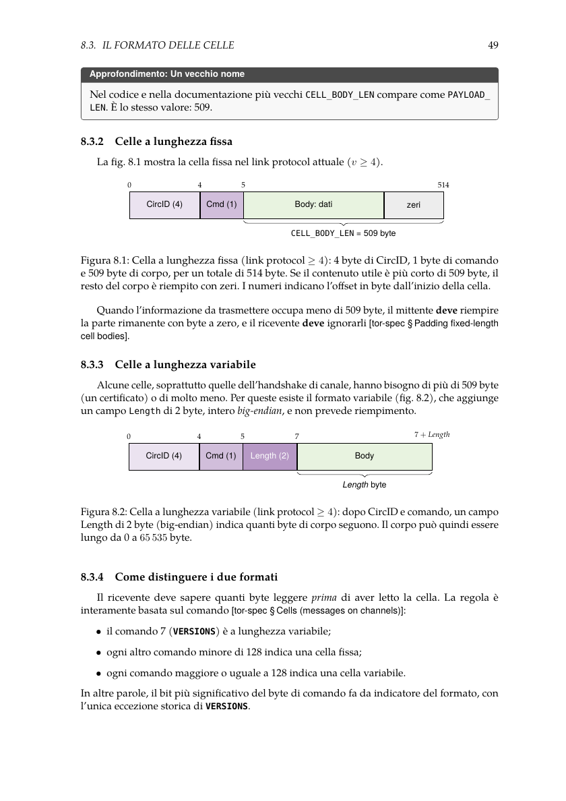
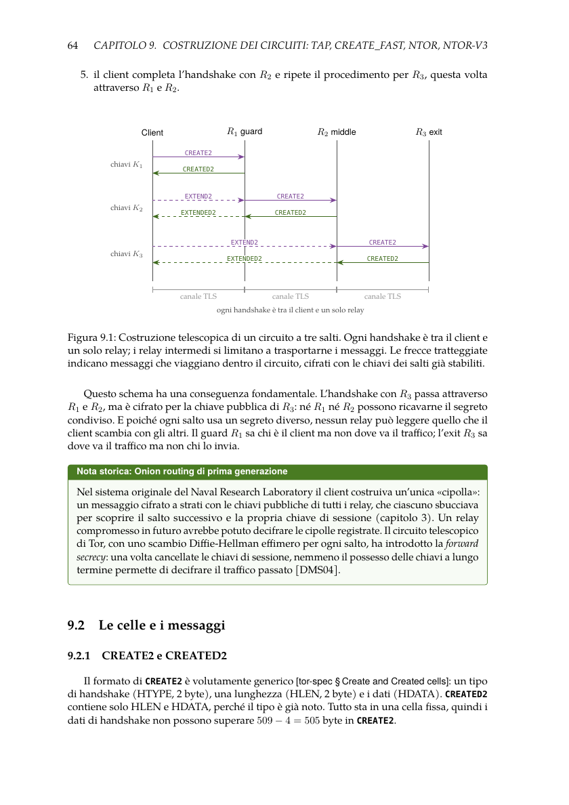
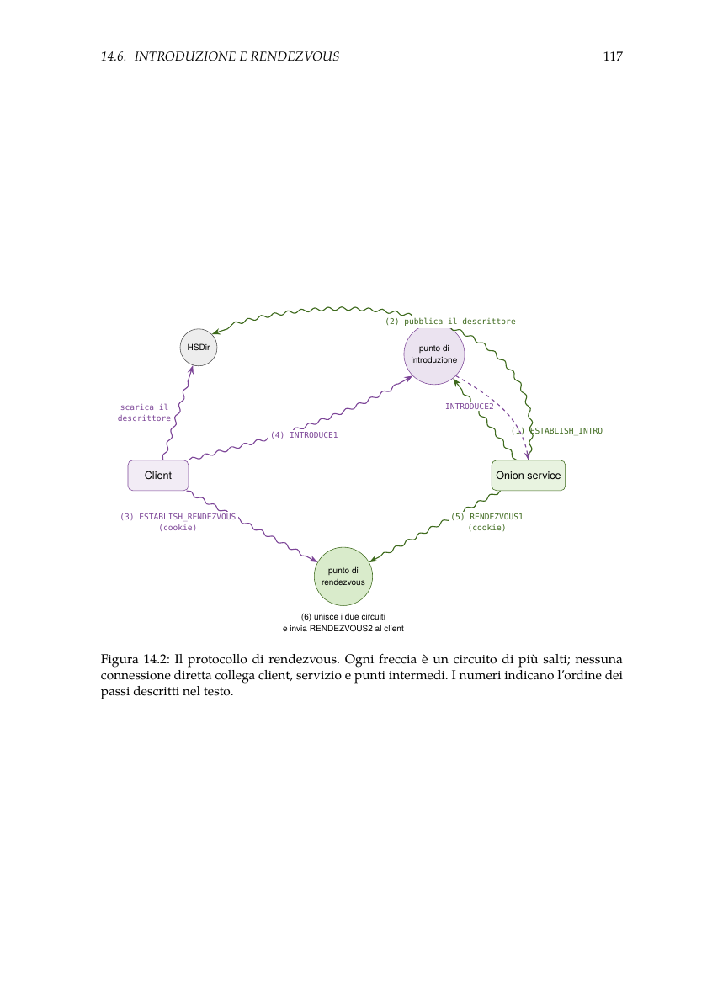
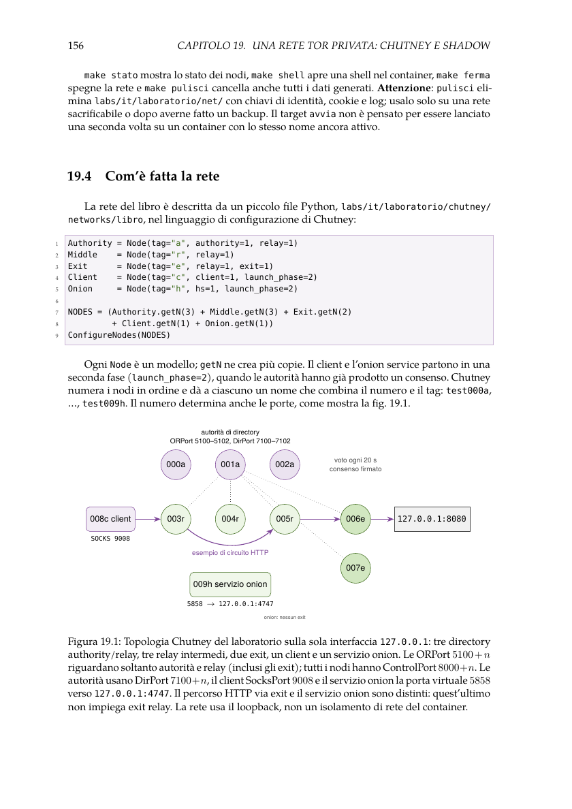

<!-- File generato da scripts/generate_readme_it.py a partire da README.md: non modificarlo a mano. -->
# Anatomia di Tor

<p align="center">
  
</p>

<p align="center"><strong>Il protocollo dell'anonimato, byte per byte</strong> · <em>Onion Routing Anatomy</em></p>

<p align="center">
  <a href="README.md#english">English</a> · <a href="#scaricare-il-libro">Libro</a> · <a href="labs/it/wiki/">Laboratori</a> · <a href="#aiuta-a-migliorare-il-libro">Contribuisci</a>
</p>

Un libro tecnico libero e gratuito sul protocollo Tor, scritto in italiano: come funziona Tor
dai byte che due relay si scambiano fino alle scelte di progetto, agli attacchi reali e ai
problemi ancora aperti, con venti laboratori che ricostruiscono e provano ogni meccanismo su una
rete Tor privata.

**Origine, metodo e invito a contribuire.** Il libro nasce da documenti e appunti di
studio che ho prodotto nel corso degli anni, a partire dalla mia tesi triennale. Sotto la mia
direzione, strumenti di intelligenza artificiale hanno contribuito in modo sostanziale ad
argomentare, organizzare e redigere questi contenuti come opera tecnica, oltre a produrre
figure, esercizi, codice e laboratori. Nonostante i controlli tecnici, non c'è stata una
revisione indipendente di esperti: possono quindi esserci errori, da segnalare e correggere
insieme ai lettori. Distribuisco gratuitamente il libro attraverso i canali ufficiali
del progetto, sotto [GPL-3.0-or-later](LICENSE), per la **«diffusione dei saperi senza
fondare poteri»**. La licenza disciplina il riuso e la redistribuzione, anche commerciale.
I dettagli sul ruolo dell'IA sono nella [dichiarazione di trasparenza](AI_DISCLOSURE.md#italiano).

Il progetto è aperto ai contributi dei lettori: segnalazioni di errori, spiegazioni più
chiare e correzioni tecniche o linguistiche. →
[Aiuta a migliorare il libro](#aiuta-a-migliorare-il-libro)

<p align="center">
  <strong>31 capitoli</strong> · <strong>20 laboratori riproducibili</strong> · <strong>176 esercizi con soluzioni</strong> · <strong>39 figure</strong>
</p>


**Vai a:** [Libro](#scaricare-il-libro) · [Laboratori](#laboratori-e-riproducibilità) · [Documentazione](docs/README.md) · [Contributi](#aiuta-a-migliorare-il-libro)

## Scaricare il libro

<p align="center">
  
</p>

**Edizione originale italiana — prima edizione**

| Formato | File |
| --- | --- |
| Lettura su schermo · PDF A4 · 298 pagine | [Apri il PDF A4](book/it/anatomia-di-tor_it_A4.pdf) |
| Lettore digitale · EPUB 3 | [Apri l'EPUB](book/it/anatomia-di-tor_it.epub) |
| Stampa di una copia personale · PDF 7×10 pollici · 342 pagine | [Apri il PDF da stampa](book/it/anatomia-di-tor_it_7x10.pdf) |
| Copertina | [Visualizza la copertina](book/it/anatomia-di-tor_it_copertina.png) |

L'edizione italiana è gratuita: puoi leggerla, scaricarla e condividerla secondo i termini della [GPL-3.0-or-later](LICENSE).


Release ufficiale: [v1.0.0-it](https://github.com/aleff-github/onion-routing-anatomy/releases/tag/v1.0.0-it) (sette file, impronte SHA-256).

**Scarica le edizioni tradotte (versione 1.0.0)**

| Lingua | PDF A4 | EPUB 3 | Copertina |
|---|---|---|---|
| English | [PDF A4](book/en/anatomy-of-tor_en_A4.pdf) | [EPUB](book/en/anatomy-of-tor_en.epub) | [Copertina](book/en/anatomy-of-tor_en_cover.png) |
| Español | [PDF A4](book/es/anatomía-de-tor_es_A4.pdf) | [EPUB](book/es/anatomía-de-tor_es.epub) | [Copertina](book/es/anatomía-de-tor_es_portada.png) |
| Русский | [PDF A4](book/ru/анатомия-tor_ru_A4.pdf) | [EPUB](book/ru/анатомия-tor_ru.epub) | [Copertina](book/ru/анатомия-tor_ru_обложка.png) |
| 简体中文 | [PDF A4](book/zh-Hans/tor-解剖_zh-Hans_A4.pdf) | [EPUB](book/zh-Hans/tor-解剖_zh-Hans.epub) | [Copertina](book/zh-Hans/tor-解剖_zh-Hans_封面.png) |

Le traduzioni, generate con strumenti di intelligenza artificiale, sono pubblicate gratuitamente, ma **non sono state sottoposte a revisione linguistica indipendente da parte di madrelingua**. Possono contenere errori di significato, terminologia o impaginazione. L'edizione originale italiana resta il riferimento. [Segnala un problema di traduzione](https://github.com/aleff-github/onion-routing-anatomy/issues/new?template=02-translation.yml). **Release GitHub delle traduzioni:** [English](https://github.com/aleff-github/onion-routing-anatomy/releases/tag/v1.0.0-en) · [Español](https://github.com/aleff-github/onion-routing-anatomy/releases/tag/v1.0.0-es) · [Русский](https://github.com/aleff-github/onion-routing-anatomy/releases/tag/v1.0.0-ru) · [简体中文](https://github.com/aleff-github/onion-routing-anatomy/releases/tag/v1.0.0-zh-Hans). La release `v1.0.0-it` contiene soltanto l'originale italiano.

## Che cosa contiene

- **Parte I — Storia e fondamenti:** anonimato e metadati, mix network e remailer, dall'onion
  routing del NRL al Tor Project, il modello di minaccia di Tor.
- **Parte II — Il protocollo a basso livello:** crittografia per Tor, architettura della rete,
  canali e link protocol, celle, costruzione dei circuiti (CREATE_FAST, ntor, ntor-v3),
  cifratura dei relay cell e CGO, stream, SENDME e controllo di congestione, sistema delle
  directory, selezione del percorso e guard, onion service v3, difese contro i DoS, censura,
  bridge e pluggable transport.
- **Parte III — Tor in pratica:** torrc, control port e Stem, una rete Tor privata, analisi del
  traffico con Wireshark, onion service, relay e bridge, Tor Browser, Tails e Whonix, Tor
  Metrics e OONI, aspetti legali ed etici in Italia e nell'UE.
- **Parte IV — Attacchi e difese:** correlazione del traffico, fingerprinting e attacchi Sybil,
  casi reali, errori operativi, con taglio analitico e difensivo.
- **Parte V — Ricerca e futuro:** la ricerca accademica su Tor, Arti (Tor in Rust), problemi
  aperti e proposte.

31 capitoli, 4 appendici, 176 esercizi graduati con soluzioni, 39 figure originali. Versioni di
riferimento: tor 0.4.9.13, Arti 2.6.0.

Sono versioni di riferimento fissate per lo studio e la riproducibilità dei laboratori,
non versioni consigliate per l'uso sulla rete Tor pubblica. Per installazioni reali
utilizzare release aggiornate con le correzioni di sicurezza.

## Pagine dal libro

Queste anteprime provengono **direttamente dal PDF A4 italiano**, senza ricostruzioni grafiche. Le pagine indicate sono quelle del PDF, non la numerazione stampata.

| Celle e formato dei byte · pagina PDF 63 | Costruzione telescopica del circuito · pagina PDF 78 |
| :---: | :---: |
| [](assets/anteprime/celle-formati.png) | [](assets/anteprime/costruzione-circuito.png) |
| Rendezvous degli onion service · pagina PDF 131 | La rete Tor privata · pagina PDF 170 |
| [](assets/anteprime/rendezvous-onion-service.png) | [](assets/anteprime/rete-privata.png) |

[Apri il PDF A4 completo](book/it/anatomia-di-tor_it_A4.pdf) · [Provenienza e SHA-256](assets/anteprime/manifest.json)

## Laboratori e riproducibilità

Venti laboratori costruiscono `torlab`, un piccolo client Tor didattico in Python, e lo provano
su una rete Tor privata (tor e Chutney compilati dai sorgenti in Docker, tutto su 127.0.0.1). Il
28 ottobre 2026 i laboratori italiani sono stati rieseguiti dal vivo: **53/53** controlli, più
**14/14** per il laboratorio sul bridge obfs4 ([riepiloghi](docs/it/validazione/)).

```bash
make -C labs/it test        # test offline (Python ≥ 3.11, pip install -r requirements.txt)
make -C labs/it immagine    # immagine Docker con tor e Chutney
make -C labs/it avvia       # avvia la rete privata
make verifica-lab           # riesegue tutti i laboratori e ne controlla i risultati
```

Gli esperimenti si fanno solo sulla rete privata, mai contro relay pubblici o utenti reali.
Guide: [`labs/it/wiki/`](labs/it/wiki/). Per compilare il libro bastano Docker e `make`:
`make book-pdf`, `make book-epub`, `make book` ([dettagli](docs/README.md)).

## Da dove nasce

Il progetto è nato come studio. Durante il lavoro per la mia tesi di laurea triennale ho
cominciato a guardare Tor sotto il livello a cui di solito viene descritto: non come si usa, ma
che cosa passa davvero fra i relay — celle, circuiti, chiavi e gli algoritmi che li tengono
insieme.

L'interesse non si è fermato con la laurea. Negli anni successivi ho continuato ad
approfondire il materiale, a riorganizzarlo e a estenderlo.

## Dalla tesi al libro

Con il tempo l'obiettivo è cambiato. Non mi bastava più capire Tor: lo scopo è diventato
un'opera tecnica capace di spiegarlo concretamente, fino al protocollo, alle celle, ai circuiti
e agli algoritmi, con ogni affermazione collegata alle specifiche e al codice sorgente.

Descrivere un meccanismo, però, non dimostra che funzioni come descritto. Da questa esigenza
nascono i laboratori: una rete Tor privata che gira su un solo computer, dove ogni passaggio del
testo si può riprodurre, misurare e verificare.

## Perché il libro è gratuito

Ho deciso di privilegiare la libera diffusione della conoscenza: l'intero progetto — il libro,
i sorgenti LaTeX, il codice e i laboratori — è liberamente disponibile, perché chiunque possa
studiarlo, riprodurlo e migliorarlo. Il libro è gratuito attraverso i canali ufficiali del
progetto; ciò che se ne può fare è stabilito dalla sua licenza, la GNU GPL versione 3 o
successiva, che permette a chiunque di ridistribuirlo, modificato o no, alle sue condizioni.

## Lingue

| Lingua | Edizione | Disponibilità |
|---|---|---|
| Italiano | Originale, versione 1.0.0 | [PDF, EPUB e PDF per la stampa](book/it/) · [release GitHub](https://github.com/aleff-github/onion-routing-anatomy/releases/tag/v1.0.0-it) |
| English | Traduzione AI, versione 1.0.0 | [PDF ed EPUB](book/en/) · revisione linguistica indipendente non completata |
| Español | Traduzione AI, versione 1.0.0 | [PDF ed EPUB](book/es/) · revisione linguistica indipendente non completata |
| Русский | Traduzione AI, versione 1.0.0 | [PDF ed EPUB](book/ru/) · revisione linguistica indipendente non completata |
| 简体中文 | Traduzione AI, versione 1.0.0 | [PDF ed EPUB](book/zh-Hans/) · revisione linguistica indipendente non completata |

Tutte e cinque le edizioni sono liberamente accessibili. In caso di divergenze fa fede l'originale italiano; [partecipa alla revisione linguistica](docs/translation-review.md).

## Uso dell'intelligenza artificiale

Il progetto, la sua origine nella ricerca e le decisioni editoriali sono miei. Il testo
attuale, le figure, gli esercizi, il codice e i laboratori sono stati redatti con un assistente
AI per la programmazione (Claude Code) sotto la mia direzione, e vanno considerati generati con
l'AI sotto direzione umana, non soltanto assistiti; le traduzioni sono state generate con
strumenti di AI. Rivedo e mantengo personalmente l'opera, e i laboratori sono stati verificati
anche con esecuzioni reali e test automatici. Non c'è stata alcuna revisione indipendente:
nessun esperto esterno, nessuna revisione giuridica del capitolo sugli aspetti legali, nessuna
revisione delle traduzioni da parte di madrelingua. Dettagli, fonti e limiti:
**[AI_DISCLOSURE.md](AI_DISCLOSURE.md)**.

## Aiuta a migliorare il libro

- [Segnala un refuso o una frase poco chiara](https://github.com/aleff-github/onion-routing-anatomy/issues/new?template=01-typo.yml)
- [Segnala un errore di traduzione](https://github.com/aleff-github/onion-routing-anatomy/issues/new?template=02-translation.yml) · [Partecipa alla revisione delle traduzioni](docs/translation-review.md)
- [Proponi una correzione tecnica](https://github.com/aleff-github/onion-routing-anatomy/issues/new?template=03-technical-correction.yml)
- [Segnala un problema in un laboratorio](https://github.com/aleff-github/onion-routing-anatomy/issues/new?template=04-laboratory.yml)
- [Proponi un miglioramento o un nuovo contenuto](https://github.com/aleff-github/onion-routing-anatomy/issues/new?template=06-proposal.yml)
- [Contribuisci al testo o al codice con una pull request](CONTRIBUTING.md)

I contributi accettati sono riconosciuti in [CONTRIBUTORS.md](CONTRIBUTORS.md) e nel
[changelog](CHANGELOG.md). Problemi di sicurezza: [SECURITY.md](SECURITY.md). Per favore segui
il [codice di condotta](CODE_OF_CONDUCT.md).

## Licenza

Copyright © 2026 Alessandro Greco. Testo, figure, copertina, sorgenti LaTeX, codice e
documentazione sono distribuiti con la **GNU General Public License versione 3 o successiva**
([`LICENSE`](LICENSE)). Materiali di terzi: [`NOTICE.md`](NOTICE.md).

## Indipendenza

Opera indipendente, non approvata né sostenuta dal Tor Project e non affiliata a esso. «Tor» e
il logo di Tor sono marchi di The Tor Project, Inc.; il libro non usa il logo.
