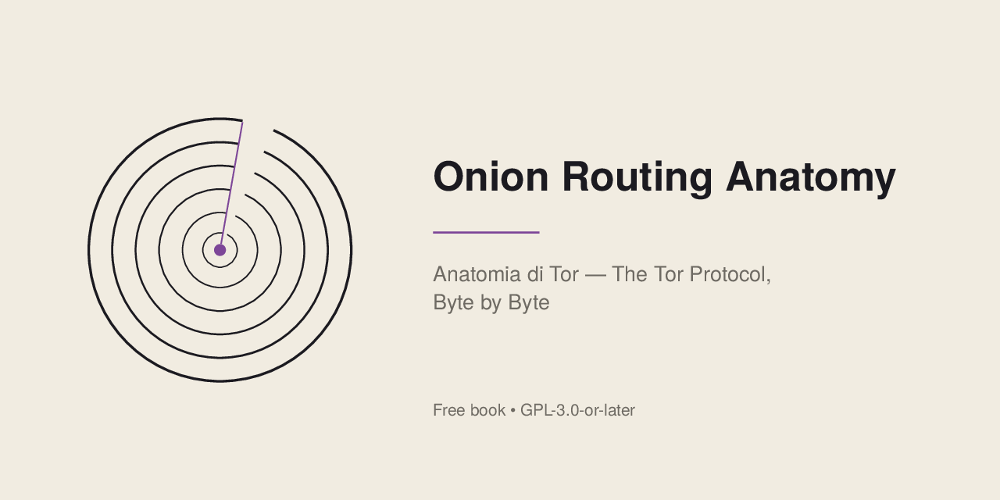
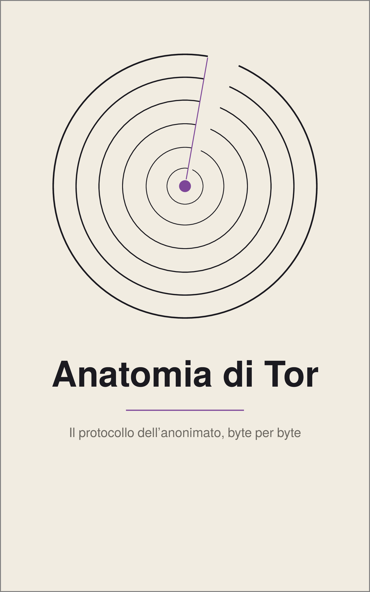
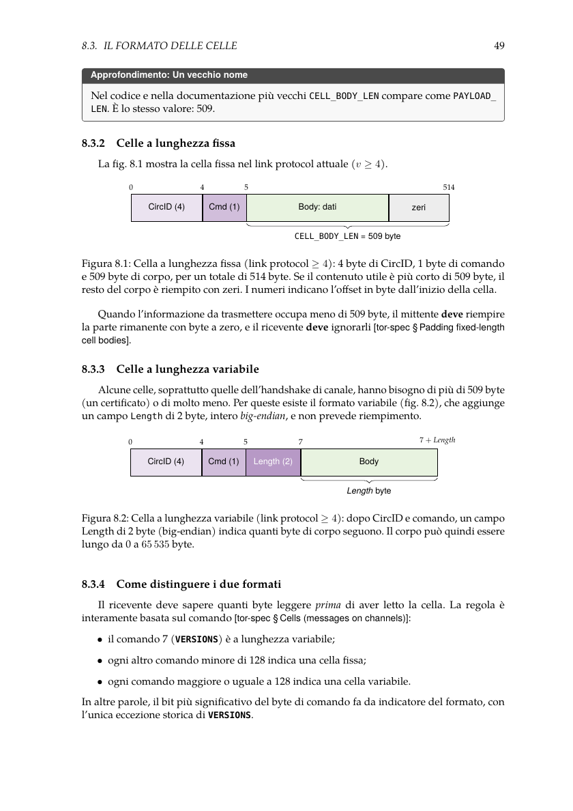
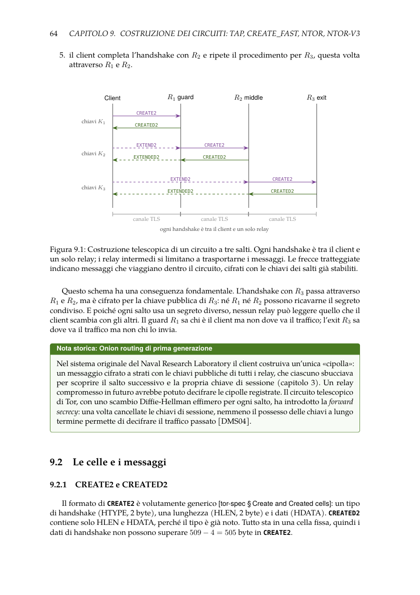
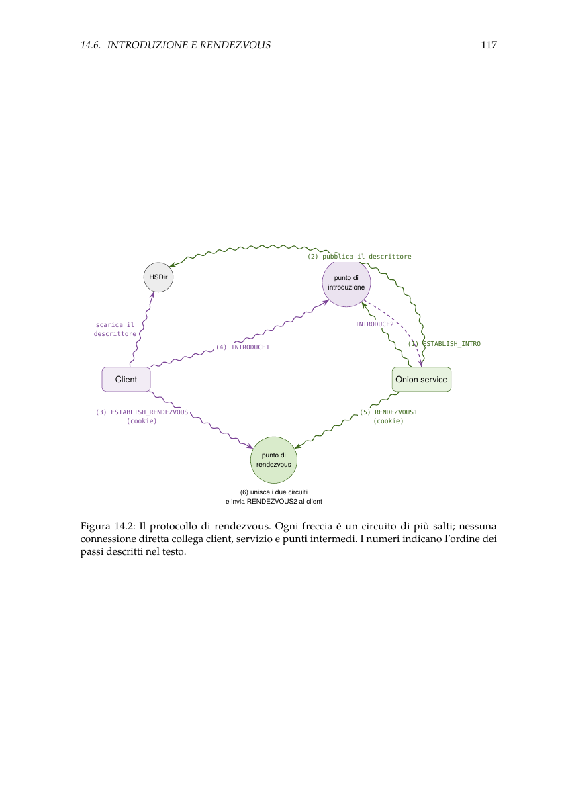
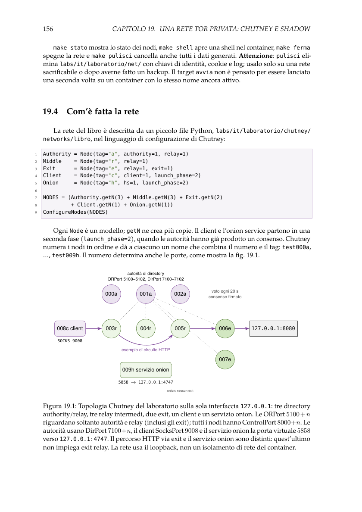

# Onion Routing Anatomy

<p align="center">
  
</p>

<p align="center"><strong>Anatomia di Tor — The Tor Protocol, Byte by Byte</strong></p>

<p align="center">
  <a href="#english">English</a> · <a href="#italiano">Italiano</a> · <a href="README.it.md">README in italiano</a>
</p>

<p align="center">
  <a href="#download">Book</a> · <a href="#laboratories-and-reproducibility">Laboratories</a> · <a href="docs/README.md">Documentation</a> · <a href="#help-improve-this-book">Contribute</a>
</p>

---

## English

A free, open-source technical book about the Tor protocol, written in Italian: how Tor works
from the bytes two relays exchange up to design choices, real attacks and open problems — with
twenty laboratories that rebuild and test each mechanism on a private Tor network.

**Origin, method, and an invitation to contribute.** This book builds on study
documents I produced over several years, beginning with my bachelor's thesis.
Under my editorial direction, AI tools made substantial contributions to expanding and
organizing that material into the present technical narrative, as well as drafting figures,
exercises, code, and laboratories. Despite technical checks, the book has not undergone
independent expert review; mistakes may remain. Readers are invited to report them and
submit corrections. I provide the work free of charge through the project's official
channels under the [GPL-3.0-or-later](LICENSE): *"diffusione dei saperi senza fondare
poteri"* — spreading knowledge without establishing power. The license allows reuse and
redistribution, including commercial redistribution, on its terms.
See [AI disclosure](AI_DISCLOSURE.md) for the precise roles and limitations.

This is an open project: readers can report errors, improve explanations and contribute
technical corrections or translations. → [Help improve this book](#help-improve-this-book)

<p align="center">
  <strong>31 chapters</strong> · <strong>20 reproducible laboratories</strong> · <strong>176 exercises with solutions</strong> · <strong>39 figures</strong>
</p>


### Download

<p align="center">
  
</p>

**Italian original — first edition**

| Format | File |
| --- | --- |
| Read on screen · A4 PDF · 298 pages | [Open A4 PDF](book/it/anatomia-di-tor_it_A4.pdf) |
| E-reader · EPUB 3 | [Open EPUB](book/it/anatomia-di-tor_it.epub) |
| Print a personal copy · 7×10 in PDF · 342 pages | [Open print PDF](book/it/anatomia-di-tor_it_7x10.pdf) |
| Cover | [View cover](book/it/anatomia-di-tor_it_copertina.png) |

The Italian edition is free to read, download and share under the conditions of the [GPL-3.0-or-later](LICENSE).


Official release: [v1.0.0-it](https://github.com/aleff-github/onion-routing-anatomy/releases/tag/v1.0.0-it) (seven files, SHA-256 checksums).

### What the book contains

- **Part I — History and foundations:** anonymity and metadata, mix networks and remailers,
  from the NRL's onion routing to the Tor Project, Tor's threat model.
- **Part II — The protocol at a low level:** cryptography for Tor, network architecture,
  channels and the link protocol, cells, circuit creation (CREATE_FAST, ntor, ntor-v3),
  layered relay encryption and CGO, streams, SENDME and congestion control, the directory
  system, path selection and guards, onion services v3, DoS defences, censorship, bridges and
  pluggable transports.
- **Part III — Tor in practice:** torrc, the control port and Stem, a private Tor network,
  traffic analysis with Wireshark, onion services, relays and bridges, Tor Browser, Tails and
  Whonix, Tor Metrics and OONI, legal and ethical aspects in Italy and the EU.
- **Part IV — Attacks and defences:** traffic correlation, fingerprinting and Sybil attacks,
  real cases, operational mistakes — with an analytical, defensive approach.
- **Part V — Research and future:** academic research on Tor, Arti (Tor in Rust), open problems
  and proposals.

31 chapters, 4 appendices, 176 graded exercises with solutions, 39 original figures. Reference
versions: tor 0.4.9.13, Arti 2.6.0.

These are fixed reference versions for study and laboratory reproducibility, not the
versions recommended for use on the public Tor network. For real deployments, install
releases that include current security updates.

### Inside the book

These are **actual pages from the Italian A4 PDF**, not promotional mockups. The page numbers refer to the PDF file, not the printed pagination.

| Cells and wire format · PDF page 63 | Telescopic circuit construction · PDF page 78 |
| :---: | :---: |
| [](assets/anteprime/celle-formati.png) | [](assets/anteprime/costruzione-circuito.png) |
| Onion service rendezvous · PDF page 131 | Private Tor network · PDF page 170 |
| [](assets/anteprime/rendezvous-onion-service.png) | [](assets/anteprime/rete-privata.png) |

[Open the complete A4 PDF](book/it/anatomia-di-tor_it_A4.pdf) · [Provenance and SHA-256](assets/anteprime/manifest.json)

### Laboratories and reproducibility

Twenty laboratories build `torlab`, a small educational Tor client in Python, and run it against
a private Tor network (tor and Chutney built from source in Docker, every listener on
127.0.0.1). On 28 October 2026 the Italian laboratories were rerun live: **53/53** checks, plus
**14/14** for the obfs4 bridge laboratory ([validation summaries](docs/it/validazione/)).

```bash
make -C labs/it test        # offline tests (Python ≥ 3.11, pip install -r requirements.txt)
make -C labs/it immagine    # Docker image with tor and Chutney
make -C labs/it avvia       # start the private network
make verifica-lab           # rerun every laboratory and check its results
```

Experiments run only on the private network, never against public relays or real users. Guides:
[`labs/it/wiki/`](labs/it/wiki/). Building the book needs only Docker and `make`:
`make book-pdf`, `make book-epub`, `make book` ([details](docs/README.md)).

### Where it comes from

The project began as study. While working on my bachelor's thesis, I started looking at Tor
below the level at which it is usually described: not how to use it, but what actually travels
between relays — cells, circuits, keys, and the algorithms that hold them together.

My interest did not end with the degree. In the following years I kept studying the material
in more depth, reorganising and extending it.

### From a thesis to a book

Over time the goal changed. It was no longer enough for me to understand Tor: the aim became a
technical work able to explain it concretely, down to the protocol, the cells, the circuits and
the algorithms, with every statement tied to the specifications and the source code.

Describing a mechanism, however, does not show that it works as described. The laboratories
come from that need: a private Tor network running on a single computer, where each step in the
text can be reproduced, measured and checked.

### Why the book is free

I decided to give priority to the free circulation of knowledge: the whole project — the book,
its LaTeX sources, the code and the laboratories — is freely available, so that anyone can
study it, reproduce it and improve it. The book is free of charge through the project's
official channels; what you may do with it is set by its licence, the GNU GPL v3 or later,
which also lets anyone redistribute it, modified or not, under its conditions.

### Languages

| Language | Edition | Status |
|---|---|---|
| Italiano (original) | First edition, version 1.0.0 | Files in `book/it/` |
| English, Español, Русский, 简体中文 | Translation review copies | AI-generated sources in `source/<language>/` and PDF, EPUB and cover review copies in `book/<language>/`. No independent native-speaker review; not part of `v1.0.0-it` ([details](docs/translations/)) |

### Use of artificial intelligence

The project, its research origin and its editorial decisions are mine. The current text,
figures, exercises, code and laboratories were drafted with an AI coding assistant (Claude
Code) under my direction, and should be regarded as AI-generated under human direction rather
than merely AI-assisted; the translations were generated with AI tools. I review and maintain
the work myself, and the laboratories were also verified by real runs and automated tests. No
independent review has taken place: no external experts, no legal review of the chapter on
law, no native-speaker review of the translations. Full details, sources and limits:
**[AI_DISCLOSURE.md](AI_DISCLOSURE.md)**.

### Help improve this book

- [Report a typo or a wording problem](https://github.com/aleff-github/onion-routing-anatomy/issues/new?template=01-typo.yml)
- [Report a translation problem](https://github.com/aleff-github/onion-routing-anatomy/issues/new?template=02-translation.yml) · [Join the translation review](docs/translation-review.md)
- [Propose a technical correction](https://github.com/aleff-github/onion-routing-anatomy/issues/new?template=03-technical-correction.yml)
- [Report a laboratory problem](https://github.com/aleff-github/onion-routing-anatomy/issues/new?template=04-laboratory.yml)
- [Suggest an improvement or new content](https://github.com/aleff-github/onion-routing-anatomy/issues/new?template=06-proposal.yml)
- [Contribute code or text with a pull request](CONTRIBUTING.md)

Accepted contributions are credited in [CONTRIBUTORS.md](CONTRIBUTORS.md) and in the
[changelog](CHANGELOG.md). Security problems: [SECURITY.md](SECURITY.md). Please follow the
[code of conduct](CODE_OF_CONDUCT.md).

### Licence

Copyright © 2026 Alessandro Greco. Text, figures, cover, LaTeX sources, code and documentation
are released under the **GNU General Public License v3.0 or later** ([`LICENSE`](LICENSE)).
Third-party material: [`NOTICE.md`](NOTICE.md).

### Independence

This is an independent work. It is not endorsed or sponsored by, or affiliated with, the Tor
Project. “Tor” and the Tor logo are trademarks of The Tor Project, Inc.; the book does not use
the logo.

---

<!-- it:inizio — questa parte e' copiata in README.it.md da scripts/generate_readme_it.py -->
## Italiano

Un libro tecnico libero e gratuito sul protocollo Tor, scritto in italiano: come funziona Tor
dai byte che due relay si scambiano fino alle scelte di progetto, agli attacchi reali e ai
problemi ancora aperti, con venti laboratori che ricostruiscono e provano ogni meccanismo su una
rete Tor privata.

**Origine, metodo e invito a contribuire.** Il libro nasce da documenti e appunti di
studio che ho prodotto nel corso degli anni, a partire dalla mia tesi triennale. Sotto la mia
direzione, strumenti di intelligenza artificiale hanno contribuito in modo sostanziale ad
argomentare, organizzare e redigere questi contenuti come opera tecnica, oltre a produrre
figure, esercizi, codice e laboratori. Nonostante i controlli tecnici, non c'è stata una
revisione indipendente di esperti: possono quindi esserci errori, da segnalare e correggere
insieme ai lettori. Distribuisco gratuitamente il libro attraverso i canali ufficiali
del progetto, sotto [GPL-3.0-or-later](LICENSE), per la **«diffusione dei saperi senza
fondare poteri»**. La licenza disciplina il riuso e la redistribuzione, anche commerciale.
I dettagli sul ruolo dell'IA sono nella [dichiarazione di trasparenza](AI_DISCLOSURE.md#italiano).

Il progetto è aperto ai contributi dei lettori: segnalazioni di errori, spiegazioni più
chiare e correzioni tecniche o linguistiche. →
[Aiuta a migliorare il libro](#aiuta-a-migliorare-il-libro)

<p align="center">
  <strong>31 capitoli</strong> · <strong>20 laboratori riproducibili</strong> · <strong>176 esercizi con soluzioni</strong> · <strong>39 figure</strong>
</p>


**Vai a:** [Libro](#scaricare-il-libro) · [Laboratori](#laboratori-e-riproducibilità) · [Documentazione](docs/README.md) · [Contributi](#aiuta-a-migliorare-il-libro)

### Scaricare il libro

<p align="center">
  
</p>

**Edizione originale italiana — prima edizione**

| Formato | File |
| --- | --- |
| Lettura su schermo · PDF A4 · 298 pagine | [Apri il PDF A4](book/it/anatomia-di-tor_it_A4.pdf) |
| Lettore digitale · EPUB 3 | [Apri l'EPUB](book/it/anatomia-di-tor_it.epub) |
| Stampa di una copia personale · PDF 7×10 pollici · 342 pagine | [Apri il PDF da stampa](book/it/anatomia-di-tor_it_7x10.pdf) |
| Copertina | [Visualizza la copertina](book/it/anatomia-di-tor_it_copertina.png) |

L'edizione italiana è gratuita: puoi leggerla, scaricarla e condividerla secondo i termini della [GPL-3.0-or-later](LICENSE).


Release ufficiale: [v1.0.0-it](https://github.com/aleff-github/onion-routing-anatomy/releases/tag/v1.0.0-it) (sette file, impronte SHA-256).

### Che cosa contiene

- **Parte I — Storia e fondamenti:** anonimato e metadati, mix network e remailer, dall'onion
  routing del NRL al Tor Project, il modello di minaccia di Tor.
- **Parte II — Il protocollo a basso livello:** crittografia per Tor, architettura della rete,
  canali e link protocol, celle, costruzione dei circuiti (CREATE_FAST, ntor, ntor-v3),
  cifratura dei relay cell e CGO, stream, SENDME e controllo di congestione, sistema delle
  directory, selezione del percorso e guard, onion service v3, difese contro i DoS, censura,
  bridge e pluggable transport.
- **Parte III — Tor in pratica:** torrc, control port e Stem, una rete Tor privata, analisi del
  traffico con Wireshark, onion service, relay e bridge, Tor Browser, Tails e Whonix, Tor
  Metrics e OONI, aspetti legali ed etici in Italia e nell'UE.
- **Parte IV — Attacchi e difese:** correlazione del traffico, fingerprinting e attacchi Sybil,
  casi reali, errori operativi, con taglio analitico e difensivo.
- **Parte V — Ricerca e futuro:** la ricerca accademica su Tor, Arti (Tor in Rust), problemi
  aperti e proposte.

31 capitoli, 4 appendici, 176 esercizi graduati con soluzioni, 39 figure originali. Versioni di
riferimento: tor 0.4.9.13, Arti 2.6.0.

Sono versioni di riferimento fissate per lo studio e la riproducibilità dei laboratori,
non versioni consigliate per l'uso sulla rete Tor pubblica. Per installazioni reali
utilizzare release aggiornate con le correzioni di sicurezza.

### Pagine dal libro

Queste anteprime provengono **direttamente dal PDF A4 italiano**, senza ricostruzioni grafiche. Le pagine indicate sono quelle del PDF, non la numerazione stampata.

| Celle e formato dei byte · pagina PDF 63 | Costruzione telescopica del circuito · pagina PDF 78 |
| :---: | :---: |
| [](assets/anteprime/celle-formati.png) | [](assets/anteprime/costruzione-circuito.png) |
| Rendezvous degli onion service · pagina PDF 131 | La rete Tor privata · pagina PDF 170 |
| [](assets/anteprime/rendezvous-onion-service.png) | [](assets/anteprime/rete-privata.png) |

[Apri il PDF A4 completo](book/it/anatomia-di-tor_it_A4.pdf) · [Provenienza e SHA-256](assets/anteprime/manifest.json)

### Laboratori e riproducibilità

Venti laboratori costruiscono `torlab`, un piccolo client Tor didattico in Python, e lo provano
su una rete Tor privata (tor e Chutney compilati dai sorgenti in Docker, tutto su 127.0.0.1). Il
28 ottobre 2026 i laboratori italiani sono stati rieseguiti dal vivo: **53/53** controlli, più
**14/14** per il laboratorio sul bridge obfs4 ([riepiloghi](docs/it/validazione/)).

```bash
make -C labs/it test        # test offline (Python ≥ 3.11, pip install -r requirements.txt)
make -C labs/it immagine    # immagine Docker con tor e Chutney
make -C labs/it avvia       # avvia la rete privata
make verifica-lab           # riesegue tutti i laboratori e ne controlla i risultati
```

Gli esperimenti si fanno solo sulla rete privata, mai contro relay pubblici o utenti reali.
Guide: [`labs/it/wiki/`](labs/it/wiki/). Per compilare il libro bastano Docker e `make`:
`make book-pdf`, `make book-epub`, `make book` ([dettagli](docs/README.md)).

### Da dove nasce

Il progetto è nato come studio. Durante il lavoro per la mia tesi di laurea triennale ho
cominciato a guardare Tor sotto il livello a cui di solito viene descritto: non come si usa, ma
che cosa passa davvero fra i relay — celle, circuiti, chiavi e gli algoritmi che li tengono
insieme.

L'interesse non si è fermato con la laurea. Negli anni successivi ho continuato ad
approfondire il materiale, a riorganizzarlo e a estenderlo.

### Dalla tesi al libro

Con il tempo l'obiettivo è cambiato. Non mi bastava più capire Tor: lo scopo è diventato
un'opera tecnica capace di spiegarlo concretamente, fino al protocollo, alle celle, ai circuiti
e agli algoritmi, con ogni affermazione collegata alle specifiche e al codice sorgente.

Descrivere un meccanismo, però, non dimostra che funzioni come descritto. Da questa esigenza
nascono i laboratori: una rete Tor privata che gira su un solo computer, dove ogni passaggio del
testo si può riprodurre, misurare e verificare.

### Perché il libro è gratuito

Ho deciso di privilegiare la libera diffusione della conoscenza: l'intero progetto — il libro,
i sorgenti LaTeX, il codice e i laboratori — è liberamente disponibile, perché chiunque possa
studiarlo, riprodurlo e migliorarlo. Il libro è gratuito attraverso i canali ufficiali del
progetto; ciò che se ne può fare è stabilito dalla sua licenza, la GNU GPL versione 3 o
successiva, che permette a chiunque di ridistribuirlo, modificato o no, alle sue condizioni.

### Lingue

| Lingua | Edizione | Stato |
|---|---|---|
| Italiano (originale) | Prima edizione, versione 1.0.0 | File in `book/it/` |
| English, Español, Русский, 简体中文 | Bozze di traduzione | Sorgenti generati con AI in `source/<lingua>/` e copie PDF, EPUB e copertine per revisione in `book/<lingua>/`. Nessuna revisione indipendente da madrelingua; escluse da `v1.0.0-it` ([dettagli](docs/translations/)) |

### Uso dell'intelligenza artificiale

Il progetto, la sua origine nella ricerca e le decisioni editoriali sono miei. Il testo
attuale, le figure, gli esercizi, il codice e i laboratori sono stati redatti con un assistente
AI per la programmazione (Claude Code) sotto la mia direzione, e vanno considerati generati con
l'AI sotto direzione umana, non soltanto assistiti; le traduzioni sono state generate con
strumenti di AI. Rivedo e mantengo personalmente l'opera, e i laboratori sono stati verificati
anche con esecuzioni reali e test automatici. Non c'è stata alcuna revisione indipendente:
nessun esperto esterno, nessuna revisione giuridica del capitolo sugli aspetti legali, nessuna
revisione delle traduzioni da parte di madrelingua. Dettagli, fonti e limiti:
**[AI_DISCLOSURE.md](AI_DISCLOSURE.md)**.

### Aiuta a migliorare il libro

- [Segnala un refuso o una frase poco chiara](https://github.com/aleff-github/onion-routing-anatomy/issues/new?template=01-typo.yml)
- [Segnala un errore di traduzione](https://github.com/aleff-github/onion-routing-anatomy/issues/new?template=02-translation.yml) · [Partecipa alla revisione delle traduzioni](docs/translation-review.md)
- [Proponi una correzione tecnica](https://github.com/aleff-github/onion-routing-anatomy/issues/new?template=03-technical-correction.yml)
- [Segnala un problema in un laboratorio](https://github.com/aleff-github/onion-routing-anatomy/issues/new?template=04-laboratory.yml)
- [Proponi un miglioramento o un nuovo contenuto](https://github.com/aleff-github/onion-routing-anatomy/issues/new?template=06-proposal.yml)
- [Contribuisci al testo o al codice con una pull request](CONTRIBUTING.md)

I contributi accettati sono riconosciuti in [CONTRIBUTORS.md](CONTRIBUTORS.md) e nel
[changelog](CHANGELOG.md). Problemi di sicurezza: [SECURITY.md](SECURITY.md). Per favore segui
il [codice di condotta](CODE_OF_CONDUCT.md).

### Licenza

Copyright © 2026 Alessandro Greco. Testo, figure, copertina, sorgenti LaTeX, codice e
documentazione sono distribuiti con la **GNU General Public License versione 3 o successiva**
([`LICENSE`](LICENSE)). Materiali di terzi: [`NOTICE.md`](NOTICE.md).

### Indipendenza

Opera indipendente, non approvata né sostenuta dal Tor Project e non affiliata a esso. «Tor» e
il logo di Tor sono marchi di The Tor Project, Inc.; il libro non usa il logo.
<!-- it:fine -->
